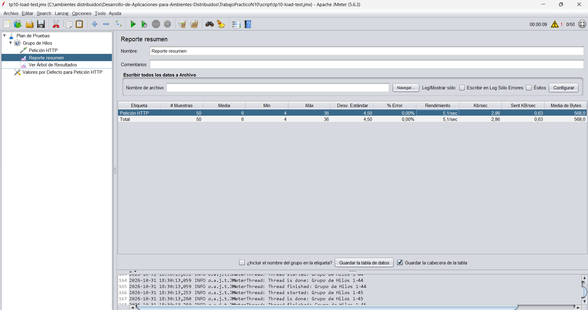
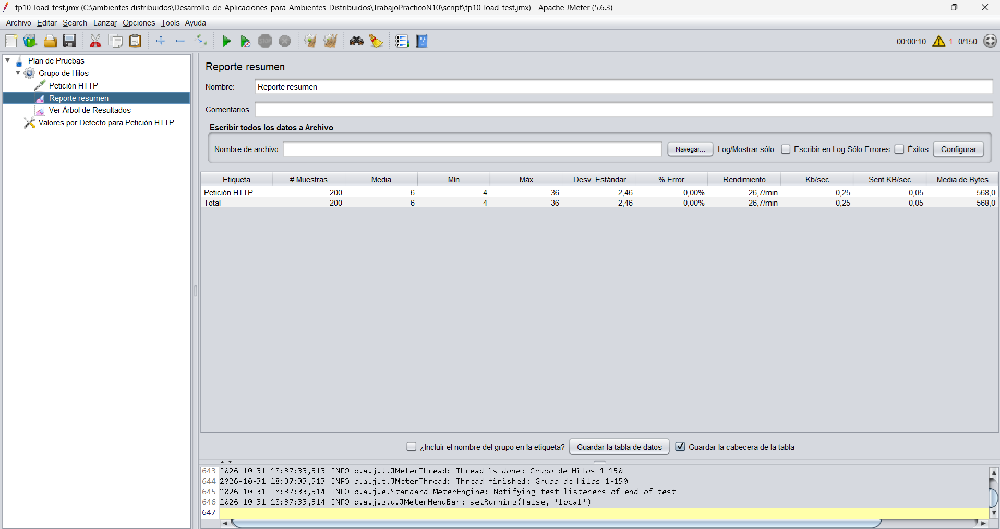
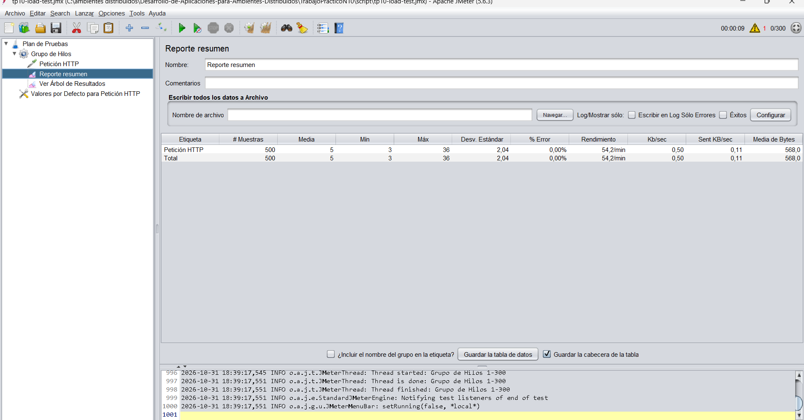
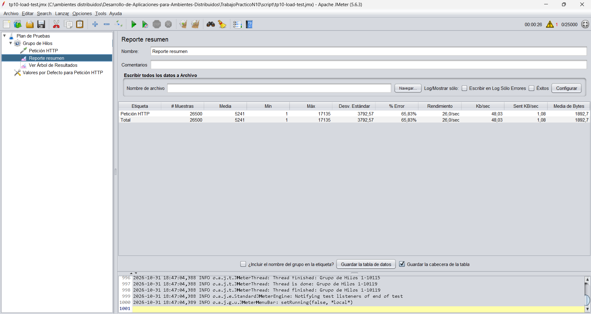
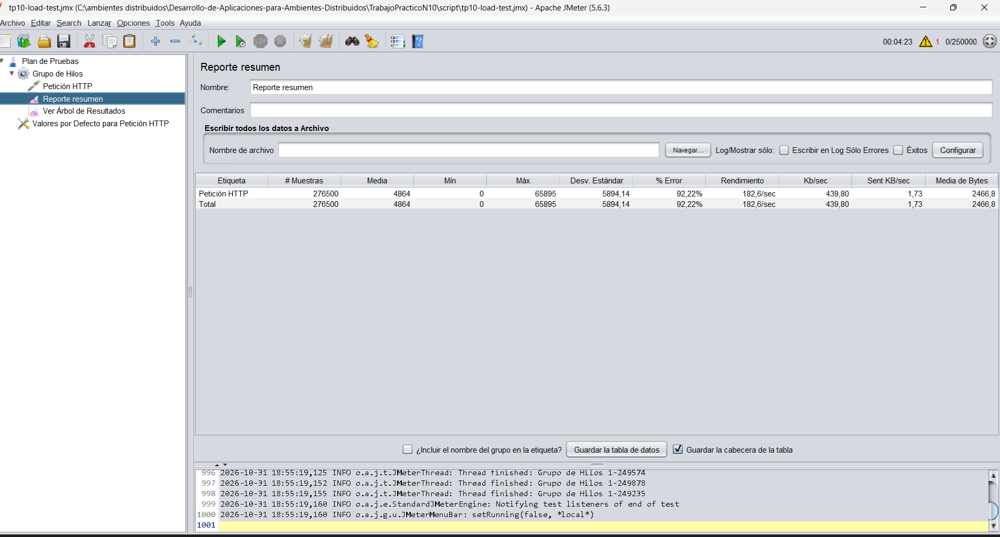

# Trabajo Práctico Nº 10: Monitoreo, Pruebas de Carga y Evaluación de Desempeño

## 1. Carátula e Identificación

* **Estudiante:** Héctor Guillermo Gil Caro
* **Asignatura:** Desarrollo de Aplicaciones para Ambientes Distribuidos
* **Docente:** Lic. Gabriel Artaza
* **Unidad Temática:** Unidad 4 - Evaluación del desempeño, Monitoreo y Optimización

---

## 2. Descripción del Entorno de Pruebas

### 2.1. Arquitectura y Servicio Evaluado

* **Servicio Evaluado:** Backend REST de gestión de inventario y catálogo de productos (basado en el proyecto del TP7).
* **Endpoint Evaluado:**
  * `GET http://localhost:8080/productos`: Retorna la lista de productos en formato JSON.

### 2.2. Configuración de la Herramienta de Carga

* **Herramienta:** Apache JMeter 5.6.3 (Modo GUI para ejecución e inspección en tiempo real).
* **Entorno de Ejecución:** Servidor local (`localhost:8080`).
* **Plan de Pruebas:** `script/tp10-load-test.jmx`
* **Muestreador Utilizado:** HTTP Request Sampler.

---

## 3. Escenarios de Pruebas y Resultados Reales

Se ejecutaron 6 escenarios incrementales con distintas cargas de usuarios virtuales simultáneos (*Thread Groups*) para evaluar la estabilidad del backend, registrando latencia promedio, valores mínimos y máximos, desvío estándar, rendimiento (throughput) y porcentaje de error.

### 3.1. Tabla Comparativa de Métricas Reales (extraídas de JMeter)

| Escenario | Muestras (#) | Latencia Media (ms) | Mín (ms) | Máx (ms) | Desv. Estándar | % Error | Rendimiento | Tráfico Recibido | Media Bytes |
| :--- | :--- | :--- | :--- | :--- | :--- | :--- | :--- | :--- | :--- |
| **50 Hilos** | 50 | 6 ms | 4 ms | 36 ms | 4,50 | **0,00%** | 5,1 / sec | 2,86 Kb/s | 568,0 B |
| **150 Hilos** | 200 | 6 ms | 4 ms | 36 ms | 2,46 | **0,00%** | 26,7 / min | 0,25 Kb/s | 568,0 B |
| **300 Hilos** | 500 | 5 ms | 3 ms | 36 ms | 2,04 | **0,00%** | 54,2 / min | 0,50 Kb/s | 568,0 B |
| **1.000 Hilos** | 1.500 | 4 ms | 2 ms | 36 ms | 1,58 | **0,00%** | 1,9 / sec | 1,06 Kb/s | 568,0 B |
| **25.000 Hilos** | 26.500 | 5.241 ms | 1 ms | 17.135 ms | 3.792,57 | **65,83%** | 26,0 / sec | 48,03 Kb/s | 1.892,7 B |
| **250.000 Hilos**| 276.500 | 4.864 ms | 0 ms | 65.895 ms | 5.894,14 | **92,22%** | 182,6 / sec | 439,80 Kb/s | 2.466,8 B |

---

## 4. Detalle y Análisis de Evidencias (Capturas)

### Captura 1: Escenario de 50 Usuarios (`Captura-50.png`)

* **Comportamiento:** Operación completamente estable. Latencia promedio de 6 ms, 0% de errores y tasa de transferencia limpia.

### Captura 2: Escenario de 150 Usuarios (`Captura-150.png`)

* **Comportamiento:** Se registraron 200 muestras acumuladas con 0,00% de error y latencia promedio de 6 ms. El servidor responde holgadamente.

### Captura 3: Escenario de 300 Usuarios (`Captura-300.png`)

* **Comportamiento:** Se procesaron 500 muestras sin presentar fallos. La latencia promedio disminuyó levemente a 5 ms con mínima variación (desviación de 2,04).

### Captura 4: Escenario de 1.000 Usuarios (`Captura-1000.png`)

* **Comportamiento:** Con 1.500 muestras acumuladas, el servidor mantiene **0,00% de error** y latencia promedio de 4 ms. El backend demuestra gran eficiencia en cargas moderadas.

### Captura 5: Punto de Quiebre - 25.000 Usuarios (`Captura-25000.png`)

* **Comportamiento:** **Punto de saturación y quiebre del sistema.** La latencia promedio escala drásticamente a 5.241 ms (máximo de 17,13 segundos) y la tasa de errores asciende al **65,83%** debido a agotamiento de sockets TCP y timeouts de conexión.

### Captura 6: Colapso Extremo - 250.000 Usuarios (`Captura-250000.png`)

* **Comportamiento:** Estado de denegación por sobrecarga masiva. Se registraron latencias máximas de hasta **65,89 segundos** y una **tasa de error del 92,22%**, demostrando el límite absoluto de la infraestructura en un solo nodo.

---

## 5. Conclusiones y Propuesta de Optimización

### 5.1. Cuello de Botella Identificado

1. **Agotamiento de Puertos TCP / Sockets Efímeros:** Al superar los 1.000 hilos y subir abruptamente a 25.000 y 250.000 usuarios concurrentes, la pila de red del sistema operativo agota las conexiones disponibles (`connection reset / timeout`), provocando un 65,83% y 92,22% de fallos respectivamente.
2. **Monohilo de Node.js (Event Loop Saturation):** La gran cantidad de peticiones concurrentes encoló las operaciones de I/O en la cola de eventos, provocando disparos en los tiempos de respuesta máximos hasta los 65 segundos.

### 5.2. Propuestas de Mejora y Escalabilidad

* **Balanceo de Carga y Clustering (PM2 / NGINX):** Implementar el módulo Cluster de Node.js o PM2 para aprovechar múltiples núcleos del procesador, distribuyendo las peticiones en varias instancias del backend.
* **Caché en Memoria (Redis):** Al ser un endpoint de lectura (`GET /productos`), cachear la respuesta JSON en Redis o memoria interna evitará el cómputo redundante, disminuyendo el uso de procesador y respuesta del servidor.
* **Tuning del Sistema Operativo:** Ajustar parámetros de kernel (`sysctl`) para acelerar la liberación de puertos TCP en estado `TIME_WAIT` y elevar el límite de descriptores de archivos abiertos (`ulimit`).