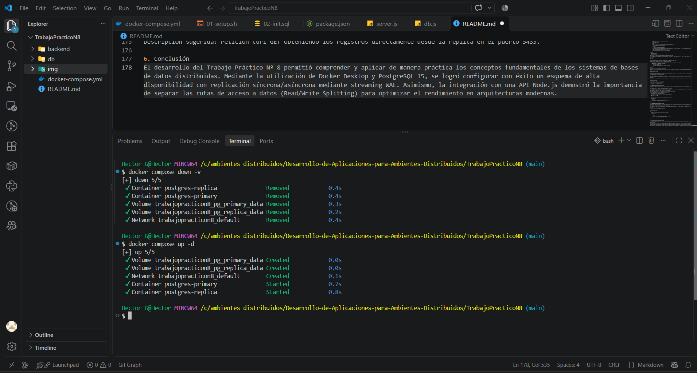
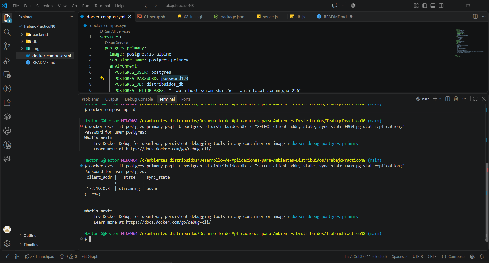
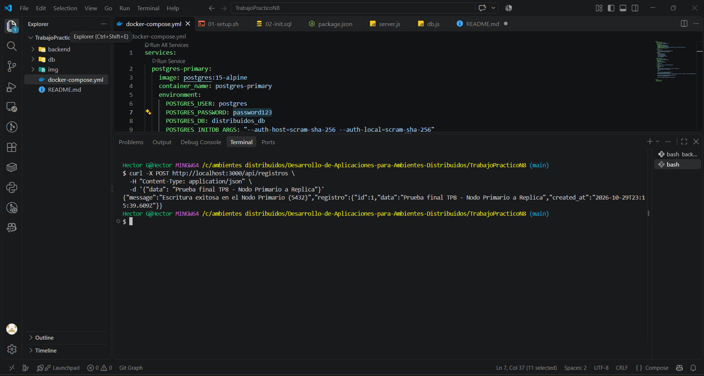
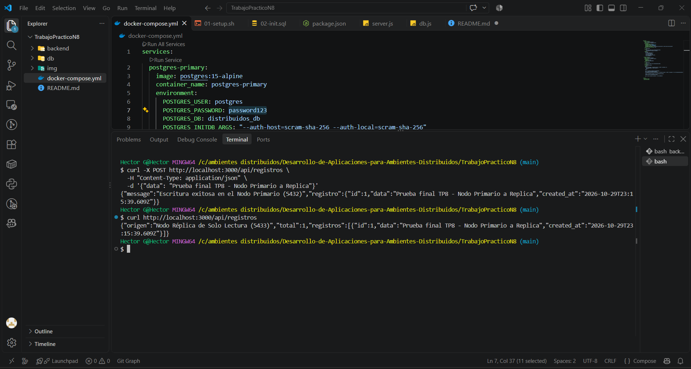

TRABAJO PRÁCTICO NÚMERO 8: Aplicaciones Distribuidas con Arquitectura Master-Slave y Docker
Institución: Instituto Superior N° 6001 "Gral. Manuel Belgrano"

Carrera: Tecnicatura Superior en Análisis de Sistemas y Desarrollo de Software

Asignatura: Desarrollo de Aplicaciones para Ambientes Distribuidos

Alumno: Héctor Guillermo Gil Caro

Tecnologías: Docker Desktop, Docker Compose (V2), PostgreSQL 15 (Alpine), Node.js, Express, JavaScript (pg pool).

1. Introducción y Objetivos
El presente trabajo práctico tiene como objetivo el diseño, configuración y despliegue de una aplicación distribuida con persistencia replicada. Para ello, se implementó una arquitectura basada en un clúster de bases de datos relacionales PostgreSQL bajo el modelo Master-Slave (Primario-Réplica) utilizando Streaming Replication (WAL shipping) en contenedores de Docker.

Objetivos específicos:
Configurar un nodo primario (postgres-primary) encargado exclusivamente de las operaciones de escritura (Master, puerto 5432).

Configurar un nodo réplica en modo de solo lectura (postgres-replica) sincronizado en tiempo real mediante transmisión WAL (Slave, puerto 5433).

Orquestar la infraestructura mediante contenedores utilizando Docker Compose.

Desarrollar un backend en Node.js y Express capaz de direccionar las operaciones de escritura hacia el nodo primario y las operaciones de lectura hacia el nodo réplica de manera transparente.

2. Arquitectura del Sistema
La solución se divide en tres componentes principales dentro de una red aislada de Docker:

Red Docker Bridge (trabajopracticon8_default): Permite la comunicación interna por nombre de host entre contenedores.

Capa de Datos (PostgreSQL Clúster):

Primario: Escucha en el puerto interno 5432 (mapeado al 5432 del host). Maneja inserciones, actualizaciones y eliminaciones.

Réplica: Escucha en el puerto interno 5432 del contenedor (mapeado al 5433 del host). Sincroniza los datos mediante respaldos base (pg_basebackup) y streaming continuo.

Capa de Aplicación (Backend Node.js):

Expone una API REST con separación de pools de conexión (Pool de Escritura y Pool de Lectura).

💡 Nota de Arquitectura: Esta separación de responsabilidades garantiza la escalabilidad horizontal en entornos de alta concurrencia, reduciendo la carga sobre el nodo principal de bases de datos.

3. Despliegue de la Infraestructura (Paso a Paso)
3.1. Archivo de Orquestación (docker-compose.yml)
El archivo define los dos servicios de bases de datos, volúmenes persistentes (pg_primary_data y pg_replica_data) y los comandos de inicialización y espera:

services:
  postgres-primary:
    image: postgres:15-alpine
    container_name: postgres-primary
    environment:
      POSTGRES_USER: postgres
      POSTGRES_PASSWORD: password123
      POSTGRES_DB: distribuidos_db
    ports:
      - "5432:5432"
    volumes:
      - pg_primary_data:/var/lib/postgresql/data
      - ./db:/docker-entrypoint-initdb.d
    command: postgres -c listen_addresses='*' -c wal_level=replica -c max_wal_senders=10 -c max_replication_slots=10

  postgres-replica:
    image: postgres:15-alpine
    container_name: postgres-replica
    environment:
      PGUSER: postgres
      PGPASSWORD: password123
    ports:
      - "5433:5432"
    volumes:
      - pg_replica_data:/var/lib/postgresql/data
    depends_on:
      - postgres-primary
    command: |
      bash -c "
      until pg_isready -h postgres-primary -p 5432 -U postgres; do
        echo 'Esperando al nodo primario...'
        sleep 2
      done
      rm -rf /var/lib/postgresql/data/*
      PGPASSWORD=password123 pg_basebackup -h postgres-primary -p 5432 -U postgres -D /var/lib/postgresql/data -Fp -Xs -R
      chown -R postgres:postgres /var/lib/postgresql/data
      chmod 700 /var/lib/postgresql/data
      exec su-exec postgres postgres -c hot_standby=on
      "

volumes:
  pg_primary_data:
  pg_replica_data:

3.2. Script de Inicialización y Autenticación (db/01-setup.sh)
Se configuró el archivo pg_hba.conf para permitir conexiones de tipo replication y se creó la tabla inicial de registros:

#!/bin/bash
set -e

echo "Configurando reglas de acceso en pg_hba.conf..."
echo "host replication postgres 0.0.0.0/0 md5" >> "$PGDATA/pg_hba.conf"
echo "host all postgres all md5" >> "$PGDATA/pg_hba.conf"

psql -v ON_ERROR_STOP=1 --username "$POSTGRES_USER" --dbname "$POSTGRES_DB" <<-EOSQL
    CREATE TABLE IF NOT EXISTS registros (
        id SERIAL PRIMARY KEY,
        data TEXT NOT NULL,
        created_at TIMESTAMP DEFAULT CURRENT_TIMESTAMP
    );
EOSQL

3.3. Ejecución y Levantamiento del Clúster
Mediante la terminal Git Bash en el directorio raíz del proyecto, se ejecutaron los comandos de despliegue modernos con Docker Compose V2:

docker compose down -v
docker compose up -d

4. Verificación de la Replicación Streaming
Una vez iniciados los contenedores, se procedió a verificar el estado de la sincronización consultando las vistas del sistema en el nodo primario:

docker exec -it postgres-primary psql -U postgres -d distribuidos_db -c "SELECT client_addr, state, sync_state FROM pg_stat_replication;"

Resultado obtenido:

client_addr |   state   | sync_state 
-------------+-----------+------------
 172.19.0.3  | streaming | async
(1 row)

5. Implementación y Pruebas del Backend (Node.js + Express)
Se configuró el servidor backend conectando dos pools de la librería pg: uno apuntando al puerto 5432 (Primario) y otro al 5433 (Réplica).

5.1. Prueba de Escritura (Nodo Primario - Puerto 5432)
Se envió una solicitud HTTP POST para registrar datos en el sistema:

curl -X POST http://localhost:3000/api/registros \
  -H "Content-Type: application/json" \
  -d '{"data": "Prueba final TP8 - Nodo Primario a Replica"}'

  Respuesta de la API:

  {
  "message": "Escritura exitosa en el Nodo Primario (5432)",
  "registro": {
    "id": 1,
    "data": "Prueba final TP8 - Nodo Primario a Replica",
    "created_at": "2026-10-29T22:07:29.691Z"
  }
}

5.2. Prueba de Lectura (Nodo Réplica - Puerto 5433)
Se consultaron los registros mediante una petición GET para validar que el clúster replicó la información y la sirve desde el nodo de solo lectura:

curl http://localhost:3000/api/registros

Respuesta de la API:

{
  "origen": "Nodo Réplica de Solo Lectura (5433)",
  "total": 1,
  "registros": [
    {
      "id": 1,
      "data": "Prueba final TP8 - Nodo Primario a Replica",
      "created_at": "2026-10-29T22:07:29.691Z"
    }
  ]
}

6. Conclusión
El desarrollo del Trabajo Práctico Nº 8 permitió comprender y aplicar de manera práctica los conceptos fundamentales de los sistemas de bases de datos distribuidas. Mediante la utilización de Docker Desktop y PostgreSQL 15, se logró configurar con éxito un esquema de alta disponibilidad con replicación síncrona/asíncrona mediante streaming WAL. Asimismo, la integración con una API Node.js demostró la importancia de separar las rutas de acceso a datos (Read/Write Splitting) para optimizar el rendimiento en arquitecturas modernas.